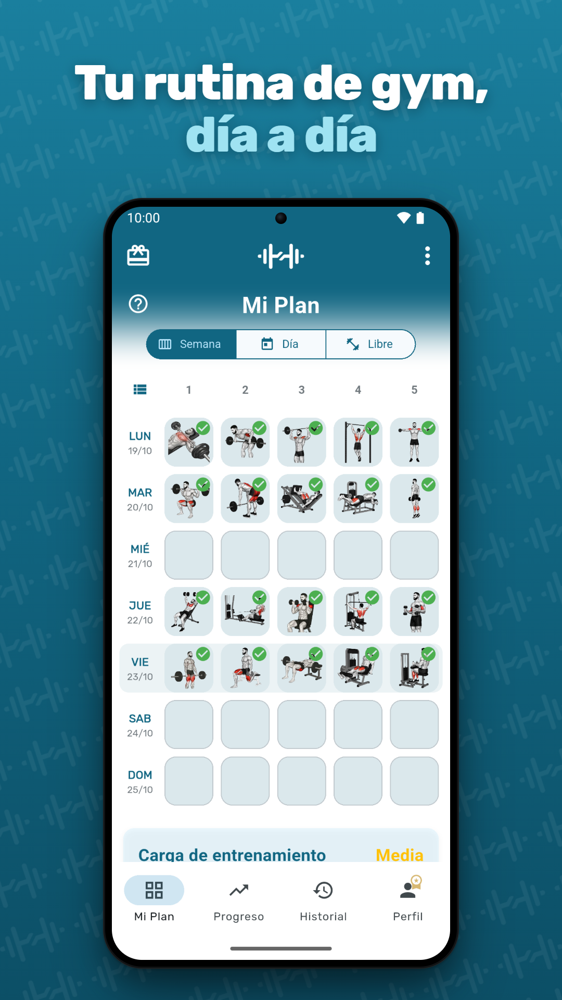
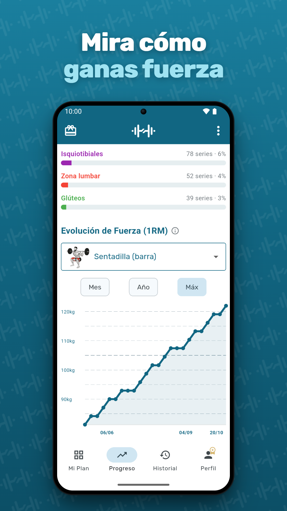
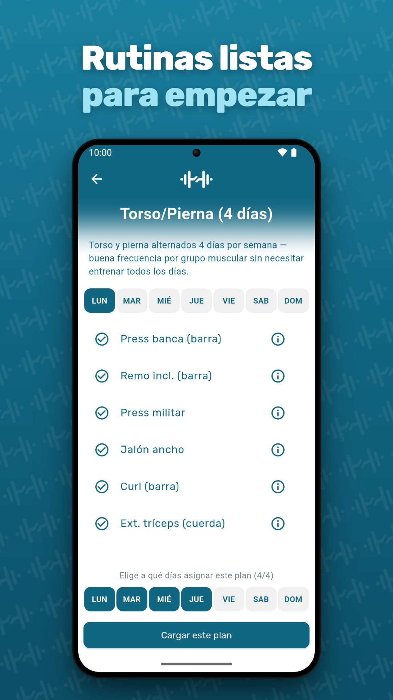
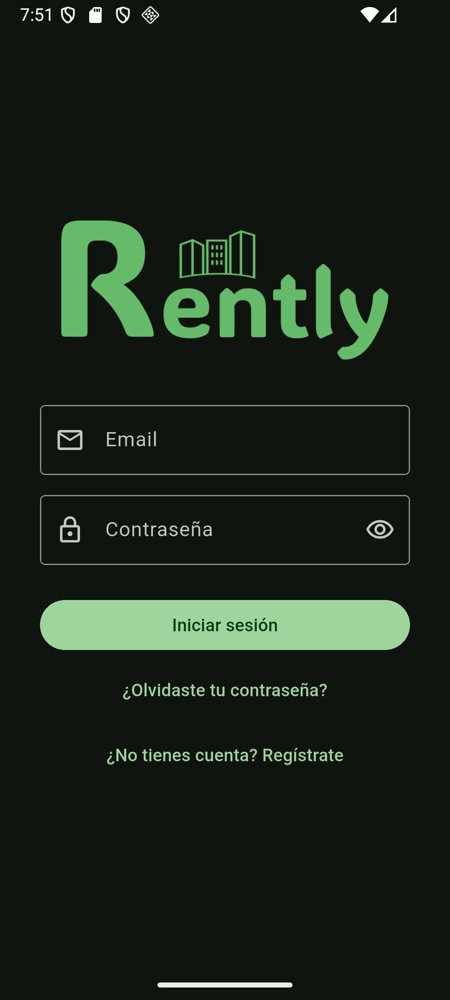
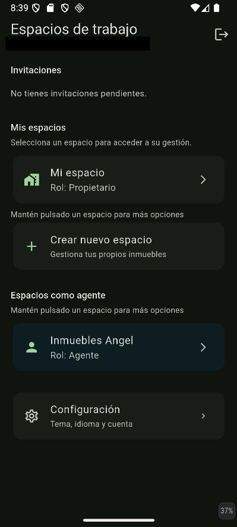
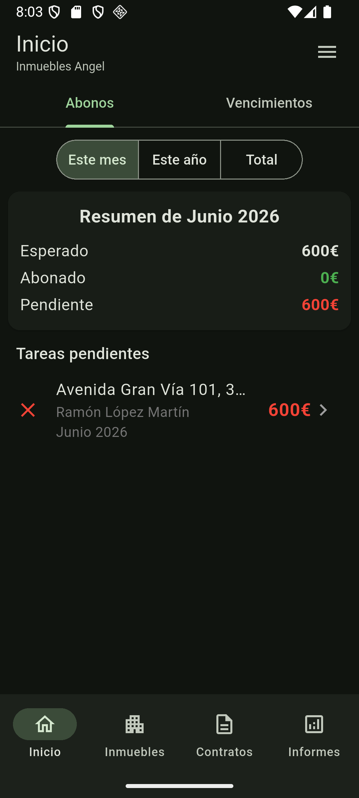
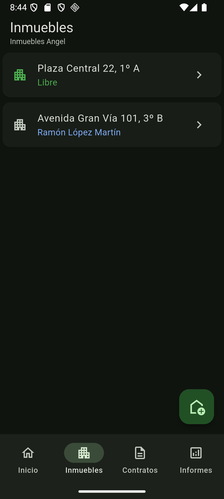
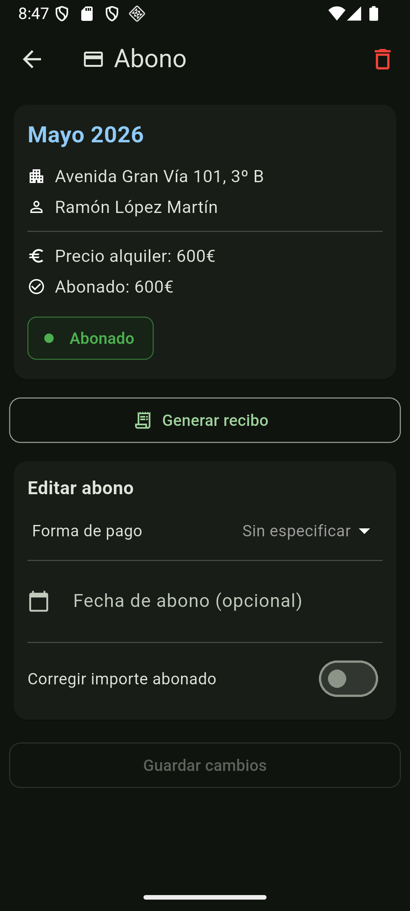
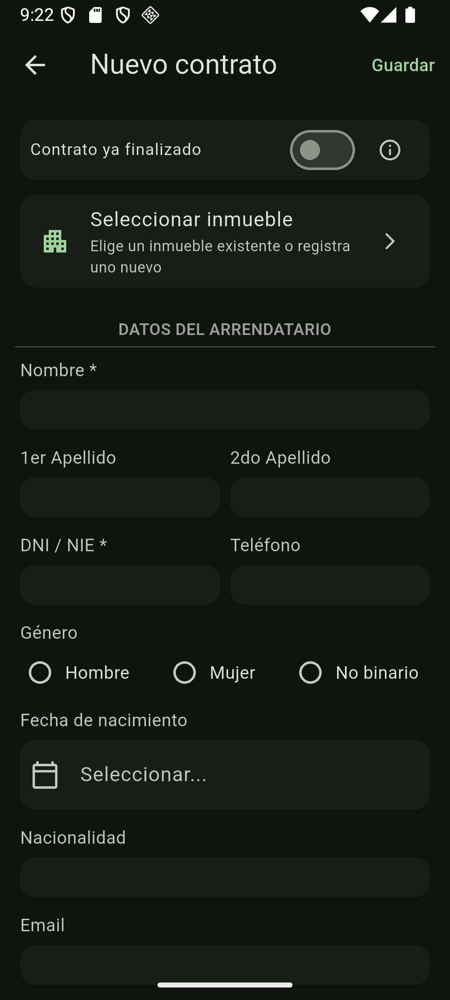

# 👋 Ángel Belzunce
### Desarrollador backend · Java · Spring Boot · APIs REST · Microservicios

📍 Villablanca, Huelva &nbsp;|&nbsp; ✉️ angelbelzunce@gmail.com &nbsp;|&nbsp; 🟢 Abierto a nuevas oportunidades

---

## 🙋 Sobre mí

Técnico Superior en Desarrollo de Aplicaciones Multiplataforma (DAM), orientado al desarrollo backend con Java y Spring Boot. Diseño APIs REST bien estructuradas, con datos consistentes, pruebas automáticas y despliegue con Docker. Desarrollo mis proyectos de forma autónoma, cubriendo todo el ciclo: diseño, base de datos, lógica de negocio e interfaz.

Antes de dedicarme al software pasé 17 años administrando y gestionando negocios, lo que me ha dado autonomía, organización y trato directo con clientes.

> Más detalles, esquemas y capturas de mis proyectos en mi **[portfolio](https://angelbelzunce.github.io)**.

---

## 🏦 Proyecto 1 — API REST Bancaria (microservicios)

**Descripción:** backend de un banco sencillo formado por dos microservicios: uno gestiona cuentas y transferencias entre ellas, y otro procesa las notificaciones de cada operación, comunicados de forma asíncrona mediante **Kafka**.

🔗 **Código:** [github.com/angelbelzunce/mini-banco](https://github.com/angelbelzunce/mini-banco)

**Aspectos técnicos destacados:**

- Arquitectura de dos microservicios (cuentas y notificaciones) comunicados por eventos con **Apache Kafka**.
- Persistencia en **PostgreSQL** con **Spring Data JPA**.
- Entorno completo levantado con **Docker Compose**.
- Tests de integración con **Testcontainers**.

**Stack técnico:**

`Java 21` · `Spring Boot` · `Spring Data JPA` · `PostgreSQL` · `Kafka` · `Docker Compose` · `JUnit` · `Testcontainers`

---

## 💸 Proyecto 2 — API REST Gastos Compartidos *(en desarrollo)*

**Descripción:** API REST para repartir gastos en grupo: usuarios, grupos, invitaciones y pagos entre miembros.

🔗 **Código:** [github.com/angelbelzunce/shared-expenses-api](https://github.com/angelbelzunce/shared-expenses-api)

**Aspectos técnicos destacados:**

- Autenticación con **JWT** y **Spring Security**, con contraseñas cifradas con **BCrypt**.
- Migraciones de base de datos versionadas con **Flyway**.
- Documentación de la API con **OpenAPI**.

**Stack técnico:**

`Java 21` · `Spring Boot` · `Spring Security` · `JWT` · `Spring Data JPA` · `PostgreSQL` · `Flyway` · `OpenAPI`

---

## 🏋️ Proyecto 3 — myRoutine: app de rutinas de gimnasio

**Descripción:** app Android para planificar la semana de entrenamiento, registrar cada serie (repeticiones, peso y RIR) y seguir la evolución de la fuerza con gráficas y estadísticas. Desarrollada por mí de principio a fin y disponible en **Google Play**, con modelo freemium (suscripción Pro y anuncios).

🌐 **Web:** [myroutinefit.com](https://myroutinefit.com)

**Capturas:**

 

**Funcionalidades principales:**

- Plan semanal personalizable y rutinas predefinidas (Full Body, Empuje/Tirón/Pierna, Torso-Pierna…) asignables a los días elegidos.
- Registro de series con repeticiones, peso y RIR, temporizador de descanso y modo de entrenamiento libre.
- Catálogo de más de 150 ejercicios con imagen, músculo trabajado y nivel.
- Progreso: 1RM estimado, volumen semanal, resumen mensual y distribución por grupo muscular.
- Sistema de logros con 10 niveles por grupo muscular, constancia y fuerza.
- Historial completo y opción de compartir cada entrenamiento como imagen.
- Recordatorios configurables por día de la semana (notificaciones locales).
- Suscripción **Pro** (mensual/anual con prueba gratuita) con **Google Play Billing**, y anuncios con **AdMob** y consentimiento RGPD (UMP) para usuarios estándar.
- App bilingüe (español/inglés).

**Aspectos técnicos destacados:**

- Arquitectura por capas (modelos, servicios, providers y pantallas) con gestión de estado mediante **Provider**.
- **Cloud Functions** en TypeScript para verificar compras en servidor, procesar notificaciones de suscripción en tiempo real (RTDN) y borrar todos los datos al eliminar una cuenta.
- Estadísticas calculadas de forma incremental (coste constante por acción en lugar de releer todo el historial), para reducir lecturas de Firestore.
- Monitorización de errores con **Crashlytics**, actualizaciones forzadas mediante **Remote Config** e In-App Updates.
- Batería de tests unitarios sobre la lógica de estadísticas, logros y fechas.

**Stack técnico:**

`Flutter/Dart` · `Firebase Firestore (NoSQL)` · `Firebase Authentication` · `Cloud Functions (TypeScript)` · `Crashlytics` · `Remote Config` · `Google Play Billing` · `AdMob` · `Android Studio`

---

## 🏠 Proyecto 4 — App de gestión de alquileres de propiedades

**Descripción:** aplicación para gestionar de forma integral propiedades en alquiler: inquilinos, contratos, pagos y documentación.

**Capturas:**

<!-- Si grabas un vídeo demo, descomenta y sustituye el enlace:
🎥 [Ver demo en vídeo](https://link-a-tu-video)
-->

**Funcionalidades principales:**

- Gestión de propiedades, contratos de alquiler y generación de informes fiscales.
- Control de pagos asociados a cada propiedad.
- Gestión de roles (propietario, agente)
- Creación de espacios propios, posibilidad de seleccionar agentes/gestores.
- Almacenamiento de documentos y archivos con **Firebase Storage** (próximamente).
- Despliegue mediante **Firebase Hosting** o **AndroidApp** (próximamente iOS).

**Stack técnico:**

`Flutter/Dart` · `Firebase Firestore (NoSQL)` · `Firebase Storage` · `Firebase Hosting` · `Firebase Authentication` · `Android Studio`

---

## 🛠️ Habilidades técnicas

| Categoría | Tecnologías |
|---|---|
| Lenguajes | Java, Kotlin, Dart, Python, SQL |
| Backend | Spring Boot, Spring Data JPA, Spring Security, JWT, APIs REST, Kafka |
| Bases de datos | PostgreSQL, MySQL, MongoDB, Firebase Firestore |
| Calidad y entrega | JUnit, Mockito, Testcontainers, Docker, GitHub Actions |
| Móvil / Full stack | Flutter, Firebase, Node.js |
| Herramientas | IntelliJ IDEA, Visual Studio Code, Git/GitHub, Claude Code, MySQL Workbench, HeidiSQL |

---|---|
| Lenguajes | Java, Kotlin, Dart, Python (básico), php (básico), HTML (básico), CSS (básico), JS(básico) |
| Móvil | Flutter, Android Studio |
| Backend / BBDD | Spring Boot, Firebase, SQL, NoSQL |
| Herramientas | IntelliJ IDEA, Visual Studio Code, Git/GitHub, Claude Code, Antigravity, MYSQLWorkbench, HeidiSQL, MongoDB |

---

## 📫 Contacto

¿Quieres hablar sobre alguno de estos proyectos o tienes una oportunidad para mí?

- ✉️ **Email:** angelbelzunce@gmail.com
- 💼 **LinkedIn:** [linkedin.com/in/ángelbelzunce](https://www.linkedin.com/in/%C3%A1ngelbelzunce/)
- 🐙 **GitHub:** [github.com/angelbelzunce](https://github.com/angelbelzunce)
- 🌐 **Portfolio:** [angelbelzunce.github.io](https://angelbelzunce.github.io)
