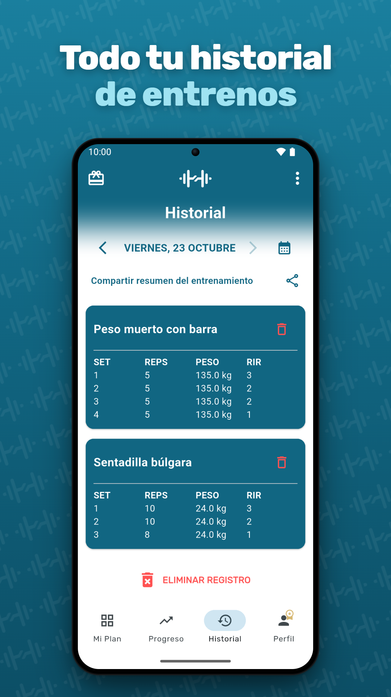
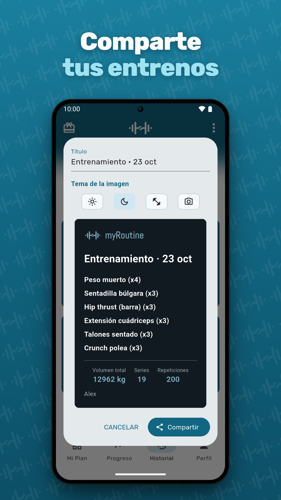
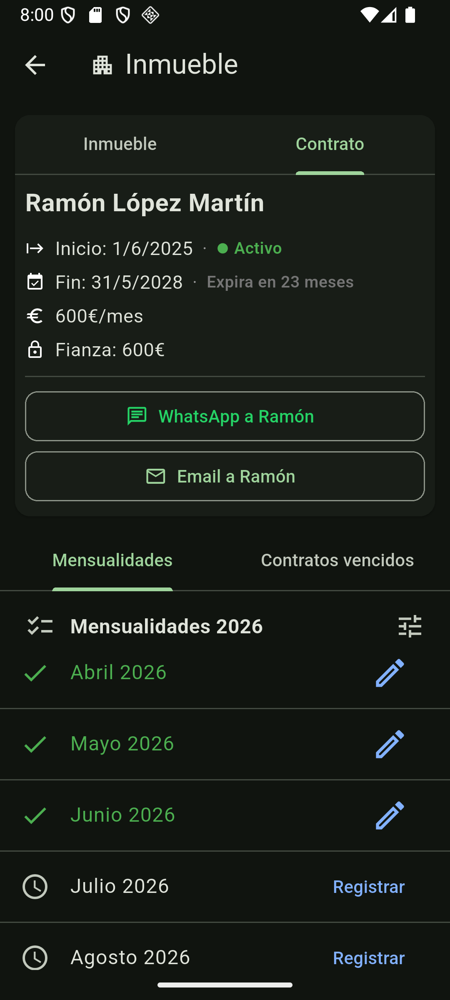
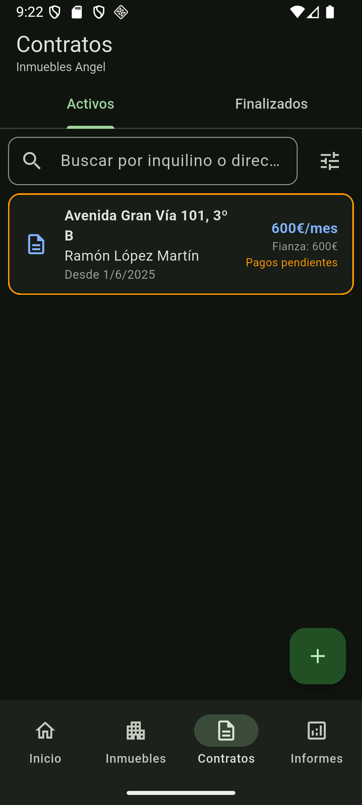

# 👋 Ángel Belzunce

### Desarrollador backend · Java · Spring Boot · APIs REST · Microservicios

📍 Villablanca, Huelva · 🟢 Abierto a nuevas oportunidades

---

## 🙋 Sobre mí

Técnico Superior en Desarrollo de Aplicaciones Multiplataforma (DAM), orientado al desarrollo backend con Java y Spring Boot. Me centro en diseñar APIs REST bien estructuradas, con persistencia en bases de datos relacionales (PostgreSQL, MySQL), seguridad con JWT y comunicación entre microservicios mediante Kafka.

Cuido la calidad del código con pruebas automáticas (JUnit, Mockito, Testcontainers) y trabajo con Docker y GitHub Actions para que todo sea reproducible y fácil de desplegar.

Además de backend, he desarrollado y publicado una app móvil completa con Flutter y Firebase, de principio a fin: diseño, base de datos, lógica de negocio e interfaz. Estoy abierto a nuevas oportunidades como desarrollador backend.

---

## 🚀 Proyectos

### 🏦 API REST Bancaria

Backend de un banco sencillo con dos microservicios (cuentas y notificaciones) comunicados por eventos con Kafka.

**Stack:** `Java 21` · `Spring Boot` · `PostgreSQL` · `Kafka` · `Docker` · `Testcontainers`

🔗 [Ver código en GitHub](https://github.com/angelbelzunce/mini-banco)

### 💸 API REST Gastos Compartidos *(en desarrollo)*

API para repartir gastos en grupo: usuarios, grupos, invitaciones y pagos, con autenticación JWT.

**Stack:** `Java 21` · `Spring Boot` · `Spring Security` · `JWT` · `PostgreSQL` · `Flyway`

🔗 [Ver código en GitHub](https://github.com/angelbelzunce/shared-expenses-api)

### 🏋️ myRoutine · app de rutinas de gimnasio

App Android para planificar la semana de entrenamiento, registrar series y seguir la evolución de la fuerza. Desarrollada de principio a fin y disponible en Google Play.

**Stack:** `Flutter` · `Firebase` · `Cloud Functions` · `Google Play Billing`

🌐 [myroutinefit.com](https://myroutinefit.com)

 

### 🏠 Rently · gestión de alquileres

App para gestionar propiedades en alquiler: inquilinos, contratos, pagos y documentación.

**Stack:** `Flutter` · `Firebase`

---

## 🛠️ Tecnologías

**Backend:** Java · Spring Boot · Spring Data JPA · Spring Security · JWT · Kafka

**Bases de datos:** PostgreSQL · MySQL · MongoDB · Firebase Firestore

**Calidad y entrega:** JUnit · Mockito · Testcontainers · Docker · GitHub Actions

**Móvil:** Flutter · Dart · Firebase · Kotlin

---

## 📫 Contacto

¿Tienes una oportunidad o quieres hablar de alguno de mis proyectos?

