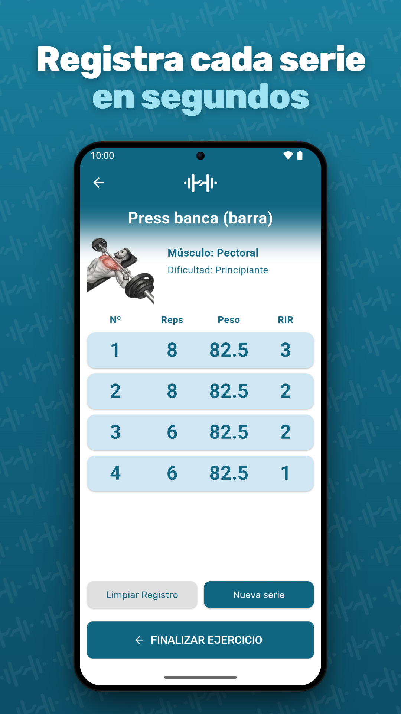
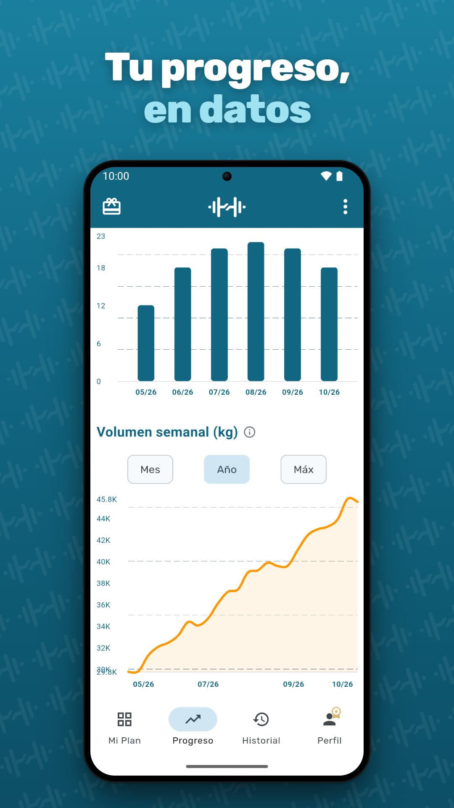
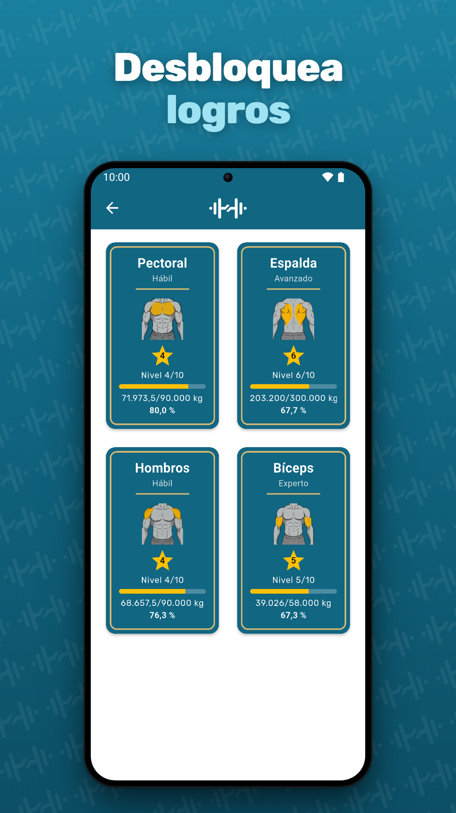

# Ángel Belzunce

### Desarrollador backend Java · Spring Boot · APIs REST · Microservicios

📍 Villablanca, Huelva · Abierto a nuevas oportunidades

---

## Sobre mí

Técnico Superior en Desarrollo de Aplicaciones Multiplataforma, orientado al desarrollo backend con Java y Spring Boot. Diseño APIs bien estructuradas, con datos consistentes y pruebas automáticas.

Antes de dedicarme al software pasé 17 años administrando y gestionando negocios, lo que me ha dado autonomía, organización y trato directo con clientes.

## Proyectos destacados

| Proyecto | Qué hace | Tecnologías |
|---|---|---|
| [**API REST Bancaria**](https://github.com/angelbelzunce/mini-banco) | Backend de un banco sencillo: gestiona cuentas, transferencias entre ellas y notificaciones de cada operación. | Java 21 · Spring Boot · PostgreSQL · Kafka · Docker |
| [**API REST Gastos Compartidos**](https://github.com/angelbelzunce/shared-expenses-api) | Reparte gastos en grupo: usuarios, grupos, invitaciones y pagos. *En desarrollo.* | Java 21 · Spring Boot · Spring Security · JWT · PostgreSQL |
| [**myRoutine**](https://myroutinefit.com) | App Android para planificar la semana de entrenamiento y seguir la evolución de la fuerza. | Flutter · Firebase · Cloud Functions |

Más detalles, esquemas y capturas en el [portfolio](https://angelbelzunce.github.io).

## Tecnologías

# Ángel Belzunce

### Desarrollador backend Java · Spring Boot · APIs REST · Microservicios

📍 Villablanca, Huelva · Abierto a nuevas oportunidades

---

## Sobre mí

Técnico Superior en Desarrollo de Aplicaciones Multiplataforma, orientado al desarrollo backend con Java y Spring Boot. Diseño APIs bien estructuradas, con datos consistentes y pruebas automáticas.

Antes de dedicarme al software pasé 17 años administrando y gestionando negocios, lo que me ha dado autonomía, organización y trato directo con clientes.

## Proyectos destacados

| Proyecto | Qué hace | Tecnologías |
|---|---|---|
| [**API REST Bancaria**](https://github.com/angelbelzunce/mini-banco) | Backend de un banco sencillo: gestiona cuentas, transferencias entre ellas y notificaciones de cada operación. | Java 21 · Spring Boot · PostgreSQL · Kafka · Docker |
| [**API REST Gastos Compartidos**](https://github.com/angelbelzunce/shared-expenses-api) | Reparte gastos en grupo: usuarios, grupos, invitaciones y pagos. *En desarrollo.* | Java 21 · Spring Boot · Spring Security · JWT · PostgreSQL |
| [**myRoutine**](https://myroutinefit.com) | App Android para planificar la semana de entrenamiento y seguir la evolución de la fuerza. | Flutter · Firebase · Cloud Functions |

Más detalles y esquemas en el [portfolio](https://angelbelzunce.github.io).

## myRoutine · app de rutinas de gimnasio

App Android para planificar la semana de entrenamiento, registrar cada serie (repeticiones, peso y RIR) y seguir la evolución de la fuerza con gráficas y estadísticas. Desarrollada por mí de principio a fin, con suscripción Pro (Google Play Billing) y anuncios (AdMob). Web: [myroutinefit.com](https://myroutinefit.com)

 

`Flutter/Dart` · `Firebase Firestore` · `Firebase Authentication` · `Cloud Functions (TypeScript)` · `Crashlytics` · `Remote Config` · `Google Play Billing` · `AdMob`

## Tecnologías

**Calidad:** JUnit · Mockito · Testcontainers

## Contacto

¿Hablamos? Escríbeme desde el [formulario del portfolio](https://angelbelzunce.github.io/#contacto) o por [LinkedIn](https://linkedin.com/in/angelbelzunce).

**Calidad:** JUnit · Mockito · Testcontainers

## Contacto

¿Hablamos? Escríbeme desde el [formulario del portfolio](https://angelbelzunce.github.io/#contacto) o por [LinkedIn](https://linkedin.com/in/angelbelzunce).
