

# 👋 Ángel Belzunce
### Desarrollador de Software · Apps Multiplataforma (Java · Kotlin · Dart · Flutter)

📍 Villablanca, Huelva &nbsp;|&nbsp; ✉️ angelbelzunce@gmail.com &nbsp;|&nbsp; 📱 669 068 698

---

## 🙋 Sobre mí

Técnico Superior en Desarrollo de Aplicaciones Multiplataforma (DAM), con conocimientos sólidos en **Java, Kotlin y Flutter/Dart**. Desarrollo mis proyectos de forma autónoma, cubriendo todo el ciclo: diseño, base de datos, lógica de negocio e interfaz. Me motiva aprender tecnologías nuevas y resolver problemas de forma independiente.

> Los repositorios de código de estos proyectos son privados. Este portfolio resume su funcionamiento, arquitectura y capturas de pantalla.

---

## 🏋️ Proyecto 1 — myRoutine: app de rutinas de gimnasio

**Descripción:** app Android para planificar la semana de entrenamiento, registrar cada serie (repeticiones, peso y RIR) y seguir la evolución de la fuerza con gráficas y estadísticas. Desarrollada por mí de principio a fin y en fase de lanzamiento en **Google Play**, con modelo freemium (suscripción Pro y anuncios).

🌐 **Web:** [myroutinefit.com](https://myroutinefit.com)

**Capturas:**

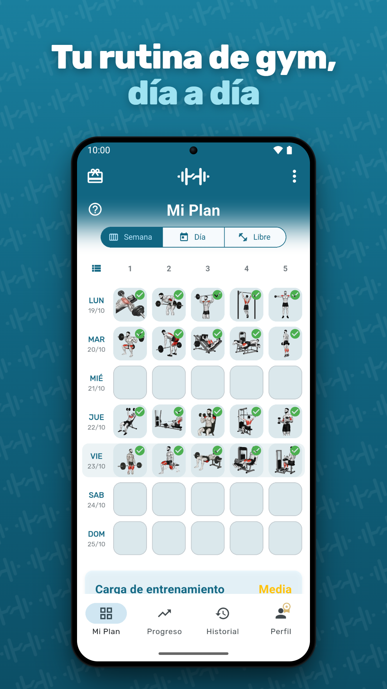
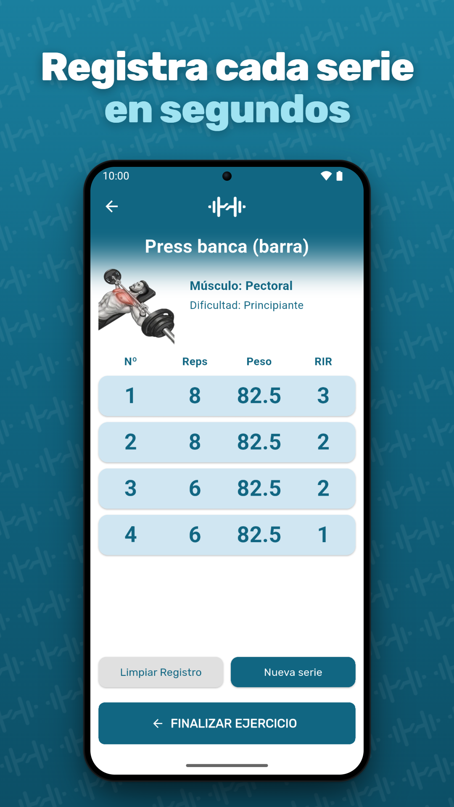
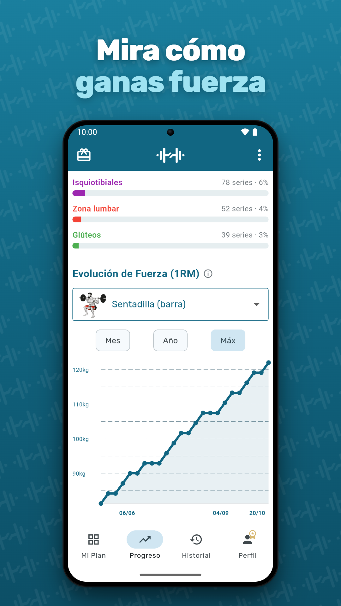
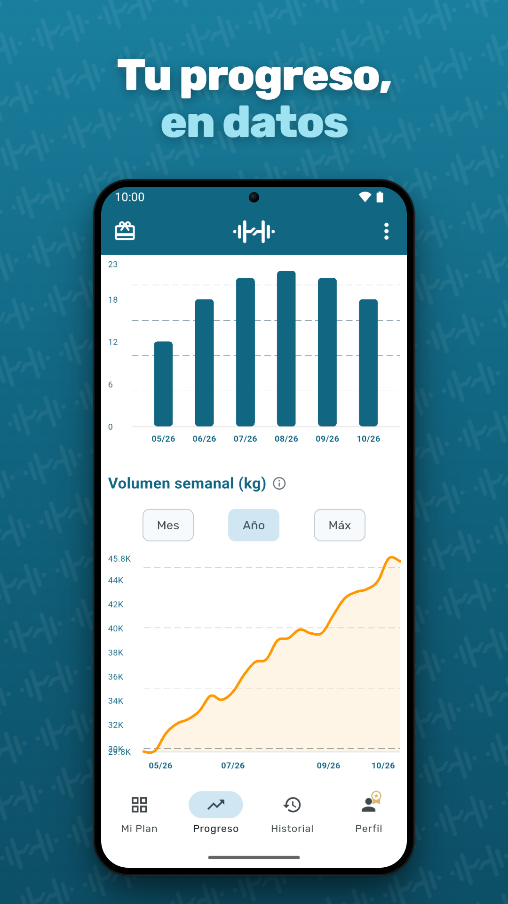
 
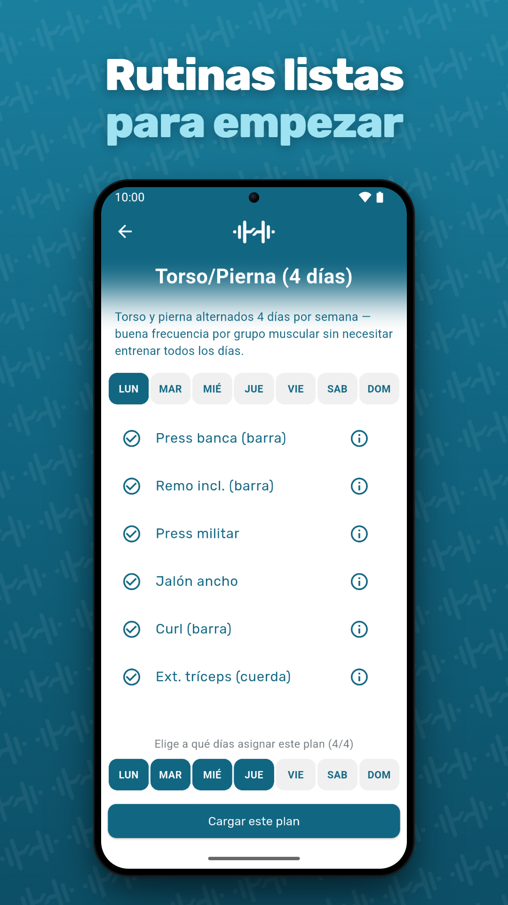
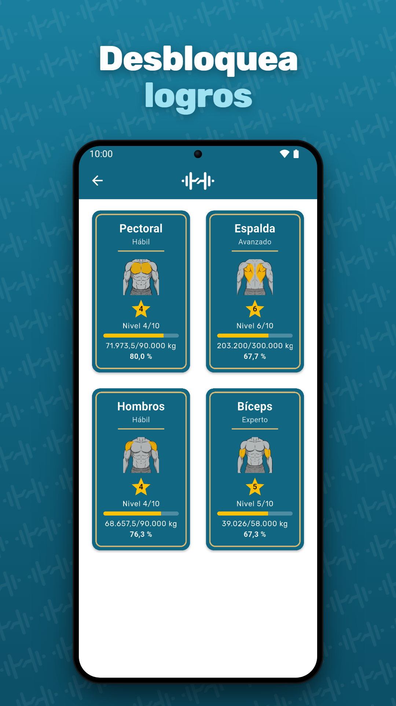
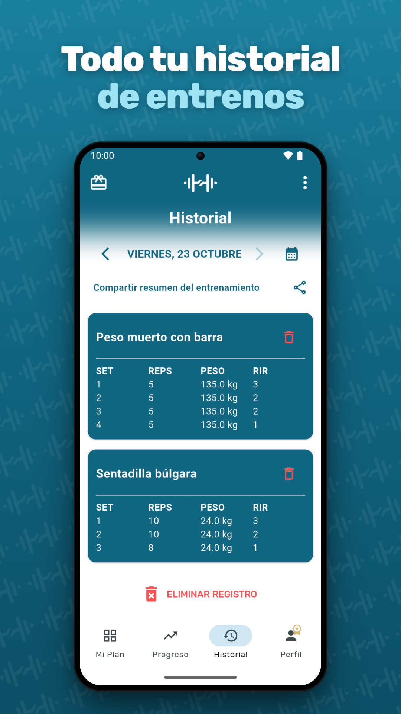
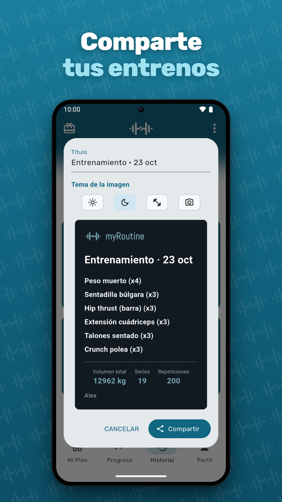

**Funcionalidades principales:**

- Plan semanal personalizable y rutinas predefinidas (Full Body, Empuje/Tirón/Pierna, Torso-Pierna…) asignables a los días elegidos.
- Registro de series con repeticiones, peso y RIR, temporizador de descanso y modo de entrenamiento libre.
- Catálogo de más de 150 ejercicios con imagen, músculo trabajado y nivel.
- Progreso: 1RM estimado, volumen semanal, resumen mensual y distribución por grupo muscular.
- Sistema de logros con 10 niveles por grupo muscular, constancia y fuerza.
- Historial completo y opción de compartir cada entrenamiento como imagen.
- Recordatorios configurables por día de la semana (notificaciones locales).
- Suscripción **Pro** (mensual/anual con prueba gratuita) con **Google Play Billing**, y anuncios con **AdMob** y consentimiento RGPD (UMP) para usuarios estándar.
- App bilingüe (español/inglés).

**Aspectos técnicos destacados:**

- Arquitectura por capas (modelos, servicios, providers y pantallas) con gestión de estado mediante **Provider**.
- **Cloud Functions** en TypeScript para verificar compras en servidor, procesar notificaciones de suscripción en tiempo real (RTDN) y borrar todos los datos al eliminar una cuenta.
- Estadísticas calculadas de forma incremental (coste constante por acción en lugar de releer todo el historial), para reducir lecturas de Firestore.
- Monitorización de errores con **Crashlytics**, actualizaciones forzadas mediante **Remote Config** e In-App Updates.
- Batería de tests unitarios sobre la lógica de estadísticas, logros y fechas.

**Stack técnico:**

`Flutter/Dart` · `Firebase Firestore (NoSQL)` · `Firebase Authentication` · `Cloud Functions (TypeScript)` · `Crashlytics` · `Remote Config` · `Google Play Billing` · `AdMob` · `Android Studio`

---

## 🏠 Proyecto 2 — App de gestión de alquileres de propiedades

**Descripción:** aplicación para gestionar de forma integral propiedades en alquiler: inquilinos, contratos, pagos y documentación.

**Capturas:**

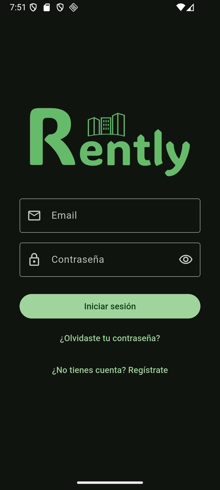
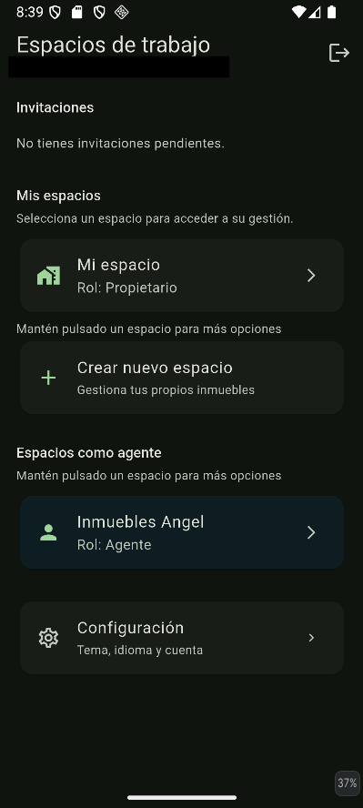
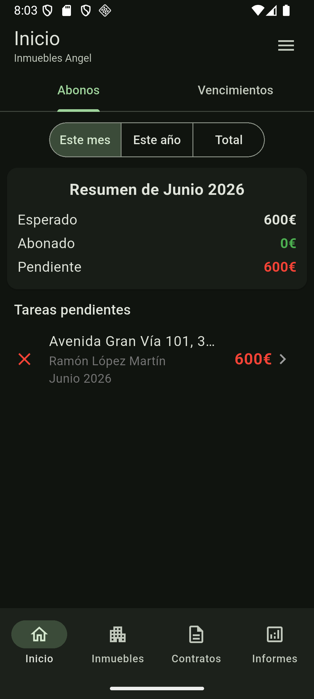
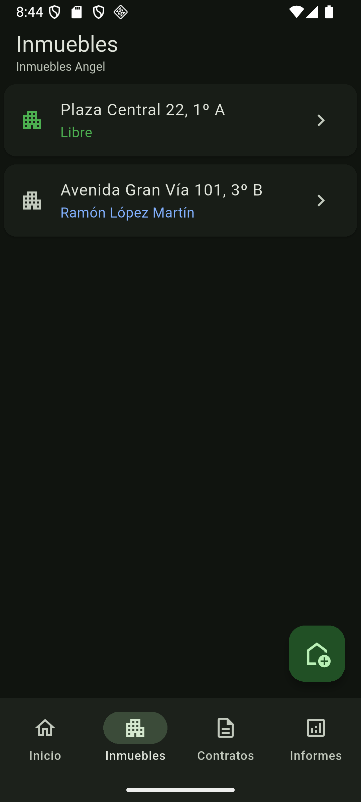
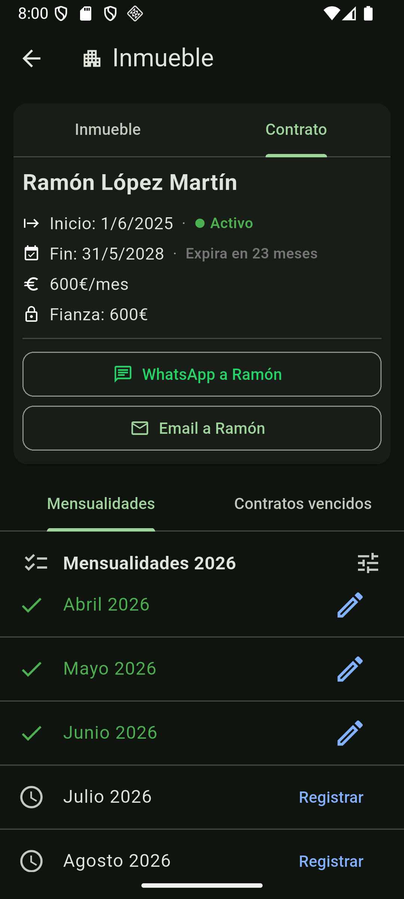
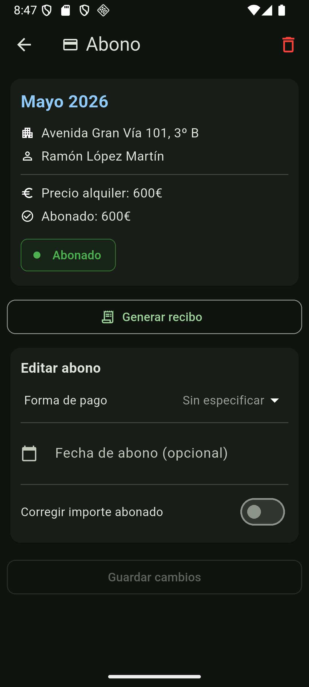
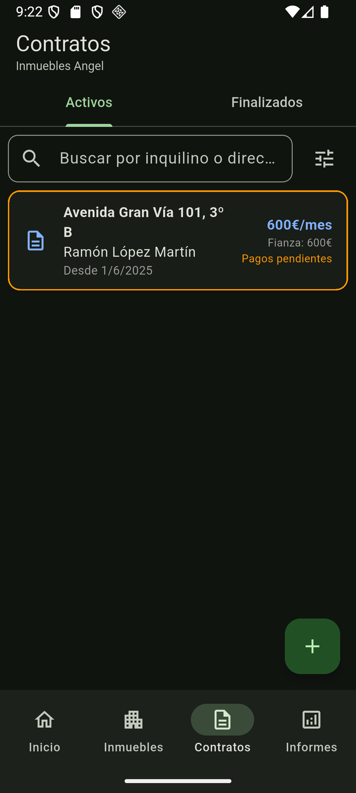
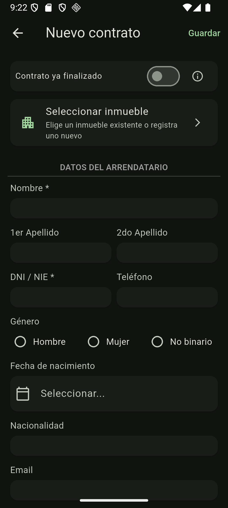

<!-- Si grabas un vídeo demo, descomenta y sustituye el enlace:
🎥 [Ver demo en vídeo](https://link-a-tu-video)
-->

**Funcionalidades principales:**

- Gestión de propiedades, contratos de alquiler y generación de informes fiscales.
- Control de pagos asociados a cada propiedad.
- Gestión de roles (propietario, agente)
- Creación de espacios propios, posibilidad de seleccionar agentes/gestores.
- Almacenamiento de documentos y archivos con **Firebase Storage** (póximamente).
- Despliegue mediante **Firebase Hosting** o **AndroidApp** (próximamente iOS).

**Stack técnico:**

`Flutter/Dart` · `Firebase Firestore (NoSQL)` · `Firebase Storage` · `Firebase Hosting` · `Firebase Authentication` · `Android Studio`

---

## 🛠️ Habilidades técnicas

| Categoría | Tecnologías |
|---|---|
| Lenguajes | Java, Kotlin, Dart, Python (básico), php (básico), HTML (básico), CSS (básico), JS(básico) |
| Móvil | Flutter, Android Studio |
| Backend / BBDD | Spring Boot, Firebase, SQL, NoSQL |
| Herramientas | IntelliJ IDEA, Visual Studio Code, Git/GitHub, Claude Code, Antigravity, MYSQLWorkbench, HeidiSQL, MongoDB |

---

## 📫 Contacto

¿Quieres hablar sobre alguno de estos proyectos o tienes una oportunidad para mí?

- ✉️ **Email:** angelbelzunce@gmail.com
- 💼 **LinkedIn:** [linkedin.com/in/ángelbelzunce](https://www.linkedin.com/in/%C3%A1ngelbelzunce/)
- 🐙 **GitHub:** [github.com/angelbelzunce](https://github.com/angelbelzunce)

